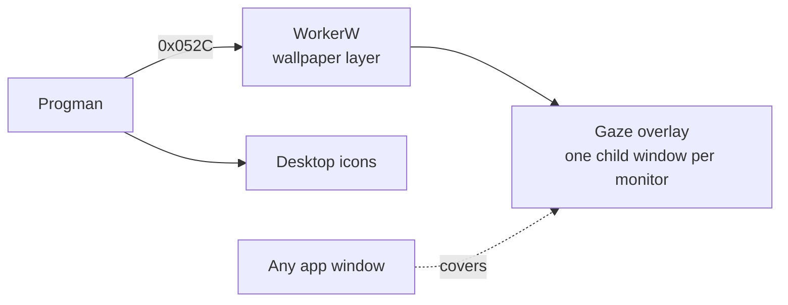

<p align="center">
  
</p>

<p align="center">
  <a href="https://github.com/Willel09/Gaze/releases/latest"></a>
  <a href="https://github.com/Willel09/Gaze/actions/workflows/build.yml"></a>
  
  <a href="LICENSE"></a>
</p>

<p align="center">
  <a href="https://github.com/Willel09/Gaze/releases/latest"><b>Download Gaze.exe</b></a>
  &nbsp;·&nbsp;
  <a href="#how-it-works">How it works</a>
  &nbsp;·&nbsp;
  <a href="docs/ARCHITECTURE.md">Architecture</a>
  &nbsp;·&nbsp;
  <a href="#build-from-source">Build</a>
</p>

---

Pick a photo of anyone, mark their eyes, and set it as your wallpaper. Whenever you are looking at the bare desktop, their pupils follow your mouse. Open a window and they stop. Press `Win` + `D` and they are watching again.

Gaze is one self-contained `.exe`. No installer, no .NET to install, no account. Your photos never leave your PC; the only network request is the update check to GitHub.

## Install

1. Open the [latest release](https://github.com/Willel09/Gaze/releases/latest) and download `Gaze-…-win-x64.exe`.
2. Run it. If SmartScreen warns about an unrecognised app, choose **More info**, then **Run anyway**. The exe is not code-signed yet.
3. Choose a wallpaper, click both eyes, press **Apply to desktop**.

**Updating:** open Gaze and press **Check for updates** (it also checks quietly on start). It downloads the new exe from the latest release and restarts itself, no reinstall. Versions before 1.1.0 have no updater, so replace those once by hand.

Needs 64-bit Windows 10 (1809 or later) or Windows 11. Close the window and Gaze keeps running in the tray, Quit lives in the tray menu.

## How it works

| Step | What you do | What Gaze does |
| --- | --- | --- |
| Choose wallpaper | Pick a JPG, PNG, WebP or BMP | Keeps a copy at full quality, corrects phone-photo rotation |
| Calibrate | Click the left and right eye, nudge the shape | Sizes the eyes from the distance between them, follows head tilt, samples the photo for iris, white and skin colour |
| Preview | Switch to Preview and move your mouse | Runs the exact renderer the desktop uses, inside the app |
| Apply to desktop | Press the button | Sets the photo as your Windows wallpaper and attaches the live eyes behind your icons |

Settings you can change at any time: eye width, height, iris and pupil size, tilt, lid shadow, tracking sensitivity, movement range, smoothness and blinking. Everything is saved, including *Start with Windows*.

### Saved backgrounds

Press **Save current** to keep a background in your library. Click any saved background to swap to it, live on your desktop if it is applied. Each one remembers its own eye marks, look and behaviour, and tweaks are saved to it automatically. The tray menu has a **Backgrounds** list and **Next background** too, so you can swap without opening the window.

### Looks and personality

- **Looks**: one tap for Natural, Cat, Goat, Demon, Robot, Ghost, Sleepy or Alien. Each sets iris, eye whites, pupil shape and eyelids, and you can keep tweaking afterwards.
- **Eyelid droop**: from wide awake to sleepy.
- **Pupil focus**: the pupils contract slightly when your cursor comes close.
- **Blink when you click**: a quick blink on every mouse click.
- **Crazy mode** — pupils look the exact opposite way from your cursor
- **Tongue** — sticks out toward your cursor; place the mouth on the photo
- **Idle life**: leave the mouse alone and the eyes start glancing around by themselves. After three minutes they fall asleep, and any movement wakes them.
- **Loupe**: a magnifier follows the pointer while you place or drag an eye, so marks are pixel-accurate.

### Cyclops mode

Switch on **Cyclops mode** to give the picture a single eye. Click once to place it, then set its size. The same shape sliders and tracking apply.

### Eye appearance

Change how the eyes look without touching the photo:

- **Iris colour**: Auto (sampled from the photo), brown, hazel, green, blue, grey, amber, red, violet or cyan
- **Eye white colour**: Auto, white, warm, bloodshot, yellow, ice or black
- **Pupil shape**: round, slit or wide
- **Highlight**: the small reflection in the eye, on or off

## Why it is part of the wallpaper

Gaze is not an always-on-top window. It uses the same layer Windows draws your wallpaper on.



- The overlays are children of the desktop's `WorkerW`, so they sit behind the icons and behind every normal window. Windows decides what covers them, not Gaze.
- They are click-through (`WS_EX_TRANSPARENT`, `HTTRANSPARENT`) and never take focus, so they cannot steal your mouse.
- Four times a second Gaze asks Windows *"what is on screen at each eye?"* with `WindowFromPoint`. If it is anything but the desktop, the 60 fps loop is detached and the process idles. Minimise everything and it resumes.
- One overlay per monitor, each cover-fitted at that monitor's native resolution and DPI.
- Windows 11 24H2 moved `WorkerW` inside `Progman`. Both layouts are handled.

Read the full write-up, including the Windows limits, in [docs/ARCHITECTURE.md](docs/ARCHITECTURE.md).

## If the eyes do not show

Windows builds stack the desktop layers differently, so Gaze has eight ways of attaching. It starts with the one that worked last time. The moment your desktop is actually visible (for example after `Win` + `D`) it paints a magenta test square, reads the screen back, and moves on to the next method until one is proven to show. That can take a few seconds the first time, and you may see the square flash once.

On Windows 11 24H2 and later (build 26100+), Windows does not show windows placed inside its wallpaper layer. Gaze then uses a small click-through window that holds only the eyes and sits directly above the wallpaper and below every app, with the photo set as your real wallpaper underneath.

1. Apply to desktop, then press `Win` + `D` and wait a few seconds.
2. Press **Open log file** and attach it, with your Windows version, to an [issue](https://github.com/Willel09/Gaze/issues).

## Performance

The photo is decoded once per monitor size. Each frame only moves two translate transforms, so WPF's GPU compositor does the drawing. When the cursor stops and the eyes settle, a frame does almost nothing. When the desktop is covered, no frames run at all.

## Known limits

- The eyes are drawn over the photo, not painted into it. Close-up, front-facing portraits look best. Heavy glasses glare or extreme head angles will look wrong.
- Fill is the only fit mode: the photo covers each monitor and is cropped, the eyes stay locked to the face.
- A translucent always-on-top overlay from another program (some game and recording overlays) counts as "covering the desktop" and pauses the eyes.
- Windows' own *Slideshow* wallpaper and *Spotlight* are replaced while Gaze is applied. *Reset settings* restores your previous wallpaper.
- WebP needs no Windows codec, Gaze decodes it itself.

## Build from source

You need the [.NET 8 SDK](https://dotnet.microsoft.com/download/dotnet/8.0) on Windows.

```bash
git clone https://github.com/Willel09/Gaze.git
cd Gaze
dotnet run --project src/Gaze
```

Run the tests (they work on any OS) and make the single-file exe:

```bash
dotnet test tests/Gaze.Tests
dotnet publish src/Gaze -c Release -r win-x64 --self-contained -p:PublishSingleFile=true -p:IncludeNativeLibrariesForSelfExtract=true -p:EnableCompressionInSingleFile=true -o out
```

The exe lands in `out/Gaze.exe`.

## Making a release

Releases are built by GitHub Actions on a Windows runner. Push a tag and the exe appears on the Releases page:

```bash
git tag v1.0.0
git push origin v1.0.0
```

Or open **Actions → Release → Run workflow** and enter a version.

## Project layout

```
src/Gaze/
  Core/        gaze math, eye layout, settings, image loading, colour sampling
  Rendering/   EyeView and WallpaperScene, shared by the preview and the desktop
  Desktop/     WorkerW lookup, per-monitor overlay windows, autostart, wallpaper
  MainWindow   calibration UI          Theme.xaml   dark theme
tests/Gaze.Tests/   unit tests for the maths and layout
.github/workflows/  build and release pipelines
```

## Contributors

<a href="https://github.com/Willel09/Gaze/graphs/contributors">
  
</a>

[@Willel09](https://github.com/Willel09) created and maintains Gaze.

## License

[MIT](LICENSE)
